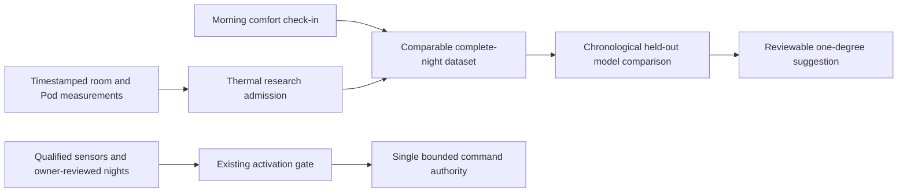

# Personal temperature learning: October 2026 review

## What Eight Sleep documents

Eight Sleep describes a preferred temperature schedule with bedtime, night,
dawn and optional thermal-alarm phases. It layers small adjustments on that
schedule using preferences, feedback and sleep/health observations. Its current
Autopilot 4.0 product page also describes workout context, room-temperature
response, sleep-stage response and learning across nights. These are vendor
descriptions; the source code, trained parameters and exact control policy are
not published in the cited pages. They are not validation of this fork.

Sources, checked 2026-10-30:

- [Temperature schedule](https://help.eightsleep.com/en_us/what-is-the-temperature-schedule-BkRoPvR66)
- [Autopilot](https://www.eightsleep.com/autopilot/)
- [Separate ambient and sleep-stage response controls](https://help.eightsleep.com/en_us/how-to-turn-autopilot-on-off-B19vVtePp)

## Separate measurements, estimates and decisions

| Input | Meaning here | Appropriate use |
| --- | --- | --- |
| Pod target | Commanded water-loop target | Compare the intended routine with acknowledgments |
| Pod reported water temperature | Hardware thermal measurement | Response/lag and comfort context; never call it body temperature |
| Cover surface temperature | Separate sensor, only when available and qualified | Surface trend; not core body temperature |
| Room temperature/humidity | Fresh, attributed bedroom sensors | Bounded ambient response and matched-night context |
| Pod HR, respiration and movement | Estimates from mechanical signals | Quality-gated comparisons; movement alone is not overheating or a sleep stage |
| Apple Watch stages/HR | Separately imported reference observations | Time-aligned validation with explicit coverage gaps |
| Watch sleeping wrist temperature | A nightly aggregate of wrist measurements | Prior-night trend with consent; not live body temperature feedback |
| Workouts/daytime activity | Person-bound Health records or explicit check-ins | Candidate next-night context after source, date and consent validation |

Apple documents one aggregated sleeping-wrist-temperature sample for the night.
HealthKit can expose it before the Health app has established its approximately
five-night display baseline. It is not an on-demand core-temperature feed.
[HealthKit definition](https://developer.apple.com/documentation/healthkit/hkquantitytypeidentifier/applesleepingwristtemperature)

## What upstream models do

SleepyPod's personal-stage workspace trains logistic regression and random
forest candidates from Pod features labeled with same-night Apple Watch stages.
Its documented comparison uses held-out nights and keeps candidates separate
from the live classifier. This predicts sleep stages; it does not establish
which temperature change benefits a particular sleeper. Historical sleep totals
without contemporaneous Pod/room measurements are not temperature-response
training examples. No cited upstream artifact supplies Eight Sleep's proprietary
Autopilot weights.

[Personal stage models](https://sleepypod.github.io/core/personal-stage-models/)
and [training workspace](https://sleepypod.github.io/developers/training/).

## Implementation in this change

Previously thermal examples were saved only when a temperature proposal was
eligible. A missing personal HR baseline could therefore prevent collecting
otherwise valid thermal examples. The new **research-only** receipt permits
collection during Preview when the side is powered, occupied, attributed and
mechanically quiet, water is adequate, the reported target is known, room data
is fresh and no manual pause, away state or alarm window is active. This does
not make the proposal eligible and cannot satisfy the reviewed-night gate.

Training requires observations spanning at least four hours, at least 48
distinct five-minute bins, and no gap over ten minutes. A change of calibration
attribution, schedule, hardware, build or bedroom configuration invalidates that
night's combined label. Missing data is not filled with zero. Large target curves
are excluded because one morning comfort rating cannot label every phase.

The existing contextual model remains advisory: at least 20 distinct matched
nights, later nights held out, comparison against hold-temperature and average
feedback baselines, no extrapolation beyond supported contexts, and at most a
one-degree suggestion. These engineering thresholds are not medical findings.

Sensor failures now name the cause: missing records, low signal, low quality,
invalid provenance, unsupported estimates, stale data, missing quiet evidence,
incomplete summaries or storage failure. This replaces an ambiguous generic
"waiting" message without weakening the acceptance rules.

## Next model experiment and acceptance

1. Preserve a simple preferred overnight baseline and separate explicit wake
   warming. Retain one-degree steps, 30-minute spacing, a three-degree total
   offset budget, user limits, manual pause and Stop priority.
2. Replay raw recordings against matched Watch intervals, including quiet
   sleepers, movement, pump transitions and known empty-bed intervals. The
   current piezo `low_signal` flag uses the presence-entry amplitude threshold;
   a Pod-specific quality model needs noise-floor and held-out evidence before
   replacing that rule. Do not infer absence from a weak piezo signal alone.
3. Add opt-in, person-bound daily context: workout timing/duration/intensity,
   daytime activity relative to that person's baseline and prior-night wrist
   temperature trend. Do not persist another sleeper's Health data under a side
   assignment or upload it to an LLM merely because a key is configured.
4. Fit interpretable regularized and neighbor-based candidates with all records
   from one night in the same split. Report per-night error, supported-condition
   coverage and uncertainty. Keep the simpler policy unless improvement holds
   on later nights. Observational association is not proof of causal benefit.
5. Evaluate phase-aware suggestions only after sleep-stage reliability is
   established. Never respond to elevated HR alone by treating it as excess heat.
6. Use the selected LLM for readable, source-grounded reports and experiment
   proposals. Deterministic controller code remains responsible for actuation.
   A more capable text model cannot repair missing or mislabeled sensor data.

The daily-context ingestion and phase-aware model are **not implemented by this
change**. It does not replace the running Pod, enable adaptive control, widen an
owner's temperature limits or alter any alarm. Deployment, physical checks and
reviewed Preview evidence remain separate acceptance steps.
