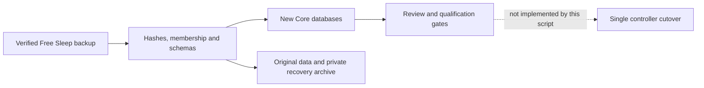

# Offline Free Sleep migration

This importer builds a **review candidate**, not an installation. It never
contacts the Pod, changes services or sends hardware commands. Keep the working
Free Sleep installation and SSH service. Do not run the upstream purge as part
of this workflow. Core cutover and rollback tooling remain separate work.



## Run

Requires Python 3.10+ with IANA timezone data. No Python packages are required.
Run from this repository with its checked-in control and biometric migrations:

```sh
python3 scripts/migration/free_sleep.py \
  --backup /absolute/path/to/free-sleep-backup \
  --output /absolute/path/to/new-review-directory
```

The backup must use `free-sleep-migration/1` from the companion Free Sleep
`scripts/migration/backup.py`, including `manifest.json`, `data.tar.gz` and
`private.tar.gz`. Output must be a new directory outside the source backup;
its parent must exist. Existing destinations are never replaced. Invalid input
removes temporary staging and leaves the source unchanged. Archive links,
traversal, duplicate/noncanonical members, missing members and checksum changes
are rejected. Directories/files are owner-only (0700/0600).

The backup format contains transactional SQLite snapshots and independently
copied settings. It does not guarantee one transaction across all stores. Take
a fresh, quiesced snapshot at eventual cutover and preserve the installation,
service units, stream configuration, SSH and firewall recovery materials too.

Output contains:

- `sleepypod.db` and `biometrics.db`, created using the checked-in Drizzle SQL
  and migration ledgers; the ordinary Drizzle migrator can subsequently resume.
- `legacy/`, with every original data file, including the legacy biometric DB,
  routines, journal and full learning history.
- `source/`, with exact copies of all three backup files. Credentials remain
  inside the private archive and are not loaded into Core settings or reports.
- `migration-report.json`, with counts, checksums, unresolved translations and
  `readyForCutover: false`. Do not point a running controller at this candidate.

## Translation contract

| Source | Candidate behavior |
| --- | --- |
| Timezone, units, side names, away mode | Validated and copied. Core-specific automatic presence controls remain at disabled defaults. |
| Daily prime/reboot | Preserve effective behavior: Free Sleep registers reboot only when daily priming is enabled, one hour before the priming clock. A requested but inactive reboot remains disabled and is reported. |
| Power | Preserve enabled state and on-target. `offDayOffset=1` only if OFF precedes ON by clock time; otherwise `0`. Equal enabled boundaries are rejected. `endAction=turn_off`. |
| Temperature phases | Earlier clocks move to the next calendar weekday. Only phases strictly inside an enabled power window are enabled. Out-of-window points are retained disabled and reported. |
| Alarms | Earlier clocks move to the next calendar weekday; disabled when the parent routine is disabled. Preserve intensity/pattern and Free Sleep's effective minimum ten-second duration. Core's wake window starts disabled. |
| Tap gestures | Translate temperature and alarm actions; unrepresentable values fail rather than round silently. |
| Personal comfort | Preserve learned offset, consumed-feedback/session cursors, manual pause and last request fields. Start Off; unsupported vital/bedtime adapters remain disabled. Preserve full original activity and timing-learning fields under `legacy/`. |
| Journal | Import dated comfort feedback, retaining all original restfulness, habits and notes under `legacy/`. Import time is a bookkeeping timestamp, not an observed sleep night. |
| Biometrics | Verify original SQLite integrity and table columns; retain it byte-for-byte. Do **not** merge old five-minute interval-start HR/HRV/respiration averages into Core's live metrics under different definitions. Historical UI/API support is pending. |
| Legacy capacitance | Preserve channel means/std as **pending** profiles. Free Sleep used summed standardized deviations; Core uses a raw-unit threshold. No threshold/quality score is guessed. Tagged newer formats require a separate adapter. |
| Transient overrides | Retain originals and report unexpired overrides; no equivalent Core override is invented. |
| Credentials/integrations | Retain privately for recovery; do not provision owner access, MQTT or HomeKit from the archive. Their Core integrations start disabled. |

## Gates that still prevent cutover

1. Qualify attended operational rollback while retaining the working
   installation and service/SSH/network configuration. The companion Free Sleep
   recovery tool now has an off-host file-restoration rehearsal for 45,126
   installation entries and 70 Bluetooth-state entries, with unchanged running
   service process IDs. That is not proof of runtime recovery or a boot image.
   See the [recovery runbook](https://github.com/lucaandrea/free-sleep/blob/b46582a/scripts/migration/RECOVERY.md).
2. Qualify overnight editing in web/native clients. Core rows are calendar
   events; Free Sleep groups phases and alarms under the evening's routine.
   APIs and the web hook's calendar-day copy round-trip an explicit OFF offset,
   including the Saturday/Sunday boundary and disabled rows. Missing offsets
   retain the legacy calendar-day default; morning temperature/alarm rows stay
   on their stored calendar weekday. The curve editor's separate delete/recreate
   workflow is not yet a complete migrated-routine editor.
3. Review enabled alarm behavior: Core adds temperature warm-up and a
   post-alarm hold that Free Sleep's alarm executor does not provide. The
   importer reports this difference; it does not claim behavioral equivalence.
4. Resolve active temporary overrides, intersecting routines and historical
   API compatibility using the preserved source data. Recheck current settings
   at cutover; this candidate is not a synchronized live replica.
5. Validate legacy occupancy against actual empty/occupied readings, then
   qualify thermal operation, attended base/Stop and vibration/cancel.
6. Run and review at least seven actual Preview nights before bounded active
   personal comfort. Imported records and synthetic tests do not count.

## Verification

```sh
python3 -m unittest discover -s scripts/migration -p 'test_*.py' -v
```

The suite uses synthetic temporary backups and the installed Node/Drizzle
runtime. It checks overnight/week-wrap mapping, disabled events, learning
cursors/manual pause, original journal/metric preservation, private archive
handling, unsafe/corrupt input, existing-target protection, cleanup, migration
ledger resumption and the default for existing Core rows. The suite runs in
CI's Unit Tests job and the pre-push hook. Core behavioral tests additionally
cover scheduler cron registration, DST Preview boundaries, individual/batch
API preservation and demo parity.

On 25 October 2026 an offline rehearsal against the owner's saved backup
produced 14 power rows, 14 alarm rows, zero temperature phases, six tap gestures,
two default-Off comfort states and zero check-ins. All power/alarm rows remained
disabled. The source snapshot contained zero vitals/movement/sleep records;
this says nothing about later or Apple Health history. Both legacy baselines
were preserved as pending. The source archives matched their manifest hashes;
no Pod service or hardware setting changed.
