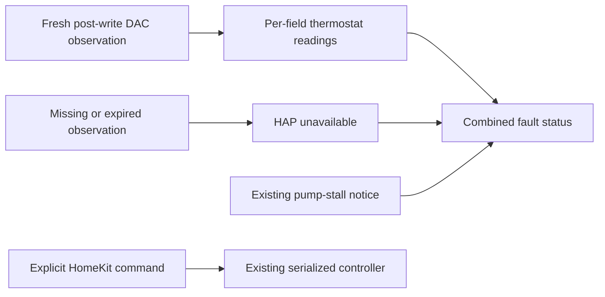

# HomeKit reported state and availability

The existing `Bed left` and `Bed right` thermostat accessories now require a
healthy, post-write DAC observation younger than fifteen seconds. Missing,
invalid, future-dated, disconnected or expired readings return HAP
`SERVICE_COMMUNICATION_FAILURE` (`-70402`). A missing temperature is never
replaced with a neutral 82.5°F value, and missing power/mode data is never
reported as OFF.

## Reported values and requests

- Current temperature uses the fresh reported current-temperature field.
  Current heat/cool/off mode is derived from the **current** level, rather than
  the target level. A requested direction does not become current mode merely
  because a command was accepted.
- These temperatures retain the existing DAC level-to-Fahrenheit conversion.
  They are not independent mattress/water thermistor measurements. The derived
  current mode is a firmware-level indication, not physical heat-flow proof.
- Target mode uses the fresh reported target level. The internal intended-power
  latch still protects command ordering but is not substituted for reported
  mode on HomeKit reads.
- A target explicitly staged while the side is OFF remains available as a
  **requested target**. It never supplies current temperature or evidence of
  power. A default power-on value is not displayed as a report.
- Null, non-finite and out-of-range fields fail individually. For example, a
  confirmed OFF mode can remain readable while temperature is unavailable.
  The service fault indicates that at least one required reading is missing.

## Freshness and faults

Reads use `DacMonitor.getFreshStatus`, which rejects observations overlapping
or preceding hardware writes. Status events are triggers to reread that cache;
their payloads are never treated as fresh merely because an event arrived.
Disconnect events withdraw values immediately. A one-second timer withdraws
expired values even without another incoming event; direct reads enforce the
exact fifteen-second boundary. Stopping the accessory removes both event
subscriptions, its timer and its fault contribution.

Telemetry and pump-notice faults share one `StatusFault` characteristic. Each
contributes independently, including on direct reads. Fresh telemetry cannot
clear a pump warning; clearing a pump warning cannot make stale telemetry
healthy. No leak accessory, new identity or pairing reset is introduced.

Commands retain their existing serialization, temperature bounds, pump guard,
manual pause and staging behavior. An explicit power-off remains available to
the handler even when status reads fail. Command success is not physical
confirmation, and a fresh report is still required afterward.

## Validation and deployment boundary

Tests use real HAP characteristics, the production DAC monitor with simulated
hardware responses, and the existing side-controller regression suite. They
exercise startup, expiry without events, clock reversal, disconnection,
intervening/delayed writes, recovery, independent faults, cleanup, off-side
staging, rejected commands and explicit power-off with unavailable status.

The bridge identity, enabled/status/unpair API contracts, native occupancy wire
contract and MQTT settings are unchanged. This is source validation. Actual
Apple Home presentation and controls—including an OFF side with unavailable
temperature—still require qualification on the deployed bridge. No owner
pairing, household automation or live Pod control was changed by these tests.
