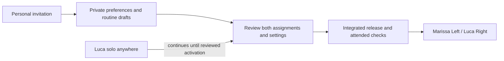

# Household readiness — October 29, 2026

The interactive guide and researched automation plan are ready to review. Private
account preparation and the internal ownership/command boundaries are merged and
tested. **The complete two-person app is not yet released.** This dated record
separates that software from the working Pod and lists the remaining integration.

- [Marissa's illustrated practice guide](../public/guide/marissa.html)
- [Home automation plan: 22 proposed automations and Shortcuts](HOME_AUTOMATION_PLAN.md)
- [Identity, transport and privacy contract](HOUSEHOLD_CONTRACT.md)

## The bed today

Luca is the sole sleeper. Live read-only checks confirm `solo-left` with the
unused thermal zone following. The sensor services report combining both zones
into one logical Left recording. “Left” is the current recording/routine source;
it is not a claim that Luca must physically remain on that half. Actual empty,
Left, Right and middle recognition still needs attended qualification under this
arrangement. Occupancy cannot identify a person.

The saved thermal routine is Sunday–Thursday at 22:00, targeting 70°F overnight.
Weekday wake warming begins at 06:30 toward 105°F, with a 20-second vibration at
07:00. The existing vibration command targets Left; thermal following does not
establish vibration coverage on Right or in the middle. Weekend Pod alarms are
disabled. The next occurrence was read back as Friday October 30 at 07:00 Pacific.

Marissa has no live account or assigned side. No calendar date changes that. There
is no new light, audio, base or notification automation enabled by this work.
Personal adaptation remains Preview; changes to the bed arrangement do not carry
over old physical qualification as if it applied to the new one.

## Merged software, not a deployment claim

| Change | Evidence | Current limit |
|---|---|---|
| [Core #63: private account preparation](https://github.com/lucaandrea/sleepypod-core/pull/63) | Local full suite: 8,375 passed, 19 skipped; browser: 34 passed; exact-head hosted checks passed. | Feature defaults off. Personal preferences and weekly drafts do not command the bed. |
| [Core #64: person-owned history](https://github.com/lucaandrea/sleepypod-core/pull/64) | 53 focused tests, 6,730 related tests passed; hosted checks passed. | Internal attribution/query service; no live ingestion or personal history route yet. |
| [Core #65: solo presence across zones](https://github.com/lucaandrea/sleepypod-core/pull/65) | 21 focused tests, 6,743 related tests passed; hosted checks passed. | Logical comfort-presence adapter; physical detection is not established by these tests. |
| [Core #66: person-bound command authority](https://github.com/lucaandrea/sleepypod-core/pull/66) | 115 focused tests; full related retry with two workers: 6,774 passed, 17 skipped; all seven exact-head hosted checks passed. | Internal service, no public control route or activation capability. |
| [Core #68: personal control API and atomic routine storage](https://github.com/lucaandrea/sleepypod-core/pull/68) | 140 focused tests; mandatory related suite: 6,817 passed, 17 skipped; production build and two actual household browser scenarios passed; all seven final hosted checks passed. | Runtime defaults off; two-person assignments in tests are fixtures. |
| [Native #47: personal account workspace](https://github.com/lucaandrea/sleepypod-ios/pull/47) | Hosted result: 1,010 passed, nine live-service tests skipped, zero failures. | Merged; not uploaded as a new TestFlight build. |
| [Native #48: account preparation refinements](https://github.com/lucaandrea/sleepypod-ios/pull/48) | All four hosted checks passed; 1,010 passed, nine skipped; six temperature UI checks and unsigned Release build passed. | Installed TestFlight remains unchanged. Personal runtime integration is a later change. |

The first broad Core #66 run had five timeouts in four independent files. Those
files passed unchanged in an isolated two-worker run (57 tests); the complete
mandatory related suite then passed unchanged with two workers. No check or hook
was bypassed. These overlapping suites are not additive independent test counts.

At this checkpoint the Pod remains on `51678cf349b52336b33665035b1f9cc077594925`.
The installed native release remains **0.4.2 (15)**. Merging is not proof of a
deployment, a TestFlight release, physical behavior or improved sleep outcomes.

## What remains before Marissa can operate her side

1. **Reviewed assignment activation.** Resolve stable accounts, preview Marissa
   Left / Luca Right, preserve Luca's actual current routine, and apply only
   Marissa's reviewed choices. Move assignments and routine ownership together.
   Invalidate old queued commands, snoozes, manual holds and qualification under
   the existing side locks. Joining alone must never perform this transition.
2. **Personal live controls and weekly alarms.** The filtered bed snapshot and
   command API now resolve current account/assignment authority and recheck it
   at hardware dispatch. The separately gated [publication API](PERSONAL_ROUTINE_API_V1.md)
   adds whole-week review, revision checks and a durable save/refresh receipt.
   Finish both clients, integrate the real side-transfer workflow and test
   independent schedules and stale callbacks through that transition. These
   implementations remain off on the live Pod.
3. **Private history and Health integration.** Attach live observations to dated
   person assignments. Review Luca's legacy records explicitly instead of
   relabeling old Left history as Marissa's. Bind Health imports, exports, caches,
   feedback, consent and models to the person. Withhold ambiguous intervals.
4. **Close every shared/legacy access path.** Restrict old owner history, raw
   exports, models, database downloads and streams before partner data exists.
   Household administration is not consent to read another person's Health data.
   Review shared HomeKit/MQTT telemetry and command consent; preserve pairings.
   MQTT live messages already use `retain:false` and clear legacy retained
   measurements on reconnect, but that does not itself establish personal consent.
5. **Web/native acceptance and release.** Freeze real route fixtures, test two
   independent accounts, account switching, credential revocation, unknown command
   outcomes, reconnection and private-data isolation. Build both clients against
   those routes. Release only the tested integrated versions.
6. **Attended two-person checks.** Confirm physical Left/Right, empty/occupied
   detection, each zone's temperature, Stop, vibration routing/cancellation and
   independent alarms. Separately review Preview nights before adaptation. These
   checks cannot be completed before the real shared arrangement exists.

## Tomorrow's ordinary wake review

Friday October 30's follow-up is at **07:15 Pacific, after waking**. Review how the
night felt, target and measured temperatures, whether warming began around 06:30,
and what happened at 07:00. No pre-wake network isolation, controller restart or
extra alarm is planned. An ordinary successful alarm is not an offline or
cancellation qualification. Recent Watch references are absent because Luca has
not worn the Watch overnight recently; missing references are not failed imports.
