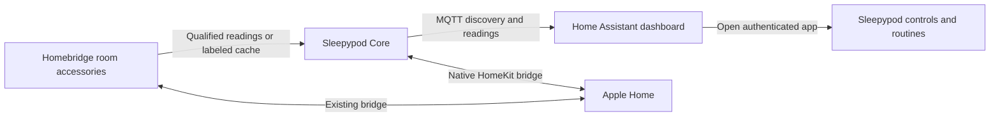

# Sleepypod dashboard

The [Tonight and Signals dashboard](sleepypod.yaml) uses Core's existing MQTT
discovery entities. It needs no HACS integration, custom JavaScript, external
fonts, new credentials or controller restart. It does not create duplicate
accessories or send bed commands.

Tonight shows each side's reported thermal state, bed presence, water-loop
temperature and Pod ambient readings. Signals shows vitals when qualified, pump
diagnostics and twelve-hour histories. Buttons open the authenticated Sleepypod
app for controls, routines, room sensors, Autopilot and diagnostics.

## Install

1. Enable Core's MQTT bridge and Home Assistant discovery using your existing
   authenticated broker. Confirm the Sleepypod device appears in Home Assistant.
2. Create a **new dashboard from scratch** in Settings → Dashboards. Choose a
   sidebar name and a URL containing a hyphen, such as `sleepypod-bedroom`.
3. Open that dashboard, choose Edit dashboard → menu → Raw configuration editor,
   and paste `sleepypod.yaml`. Do not replace an existing household dashboard.
4. Replace `http://sleepypod.local:3000` with the Pod's verified address or an
   authenticated private HTTPS gateway. The sample hostname is a placeholder;
   this file does not configure mDNS or remote access. Never include a connection
   key in a URL. Direct LAN links only work where that LAN is reachable.
5. Map every entity ID to the actual discovered entities. The example uses the
   default `sleepypod_eight_pod` prefix, but Home Assistant can rename IDs or add
   suffixes. Check Settings → Devices & services → Entities, or add the device's
   suggested cards temporarily and inspect their raw configuration. In particular,
   the beat-interval entity name differs from its internal `hrv` unique ID.
6. Save, exit editing, and inspect both views. Check that all 19 entities resolve;
   an existing entity can legitimately be **Unavailable**. That is different from
   **Entity not found**, which means the mapping needs correction. Verify each app
   link and the layout on a narrow screen.

The file is ordinary dashboard YAML using built-in Home Assistant cards. See the
official [dashboard](https://www.home-assistant.io/dashboards/dashboards/) and
[tile-card](https://www.home-assistant.io/dashboards/tile/) documentation.

## Data and control boundaries

- Left and right identify hardware sides, not people. Sleeper assignments stay
  in Core; this dashboard does not assign either side to a household member.
- Occupancy is not measured sleep, sleep stages or identity. Missing telemetry
  stays unavailable. No template substitutes zero for a missing sensor.
- Climate temperatures are firmware-reported values. Water-loop temperatures
  and room readings are distinct. The climate mode `heat` means thermal control
  is active and can include cooling. See [telemetry](../../../docs/HOME_TELEMETRY.md).
- The standard dashboard only monitors MQTT. It does not expose climate sliders,
  alarm tests, priming, raw firmware commands, reboot or update services. Controls
  stay in the existing authenticated app. Enabling MQTT writes is a separate
  deployment requiring scoped broker access and the checks in
  [MQTT commands](../../../docs/MQTT_COMMANDS.md).
- Vitals require qualified signals. Unavailable vitals are not proof of sensor
  failure; base/mechanical qualification may withhold them.
- Saving this dashboard does not enable any house automation. See the reviewed
  [blueprints](../README.md) for opt-in scene workflows.

## Homebridge and Apple Home

Core already has a native HomeKit bridge. Pair that bridge once with Apple Home,
where it can coexist with Homebridge accessories. Do not install an MQTT-to-
HomeKit thermostat plugin for the same bed or re-export its HA climate entities
through another HomeKit bridge; those paths create duplicate accessories.

Homebridge room data travels in the other direction: the existing bedroom
publisher supplies qualified source readings or explicitly cached values to
Core. Check **Sleepypod → Home** for provider, freshness and eligibility. A recent
cache read does not establish a new physical measurement. Apple Home's HomePod
sensors still need the separate [export workflow](../HOMEPOD_SENSOR_EXPORT.md).

Removing this newly created dashboard reverses the UI installation. It does not
remove MQTT entities, histories, HomeKit pairings or Pod routines.
